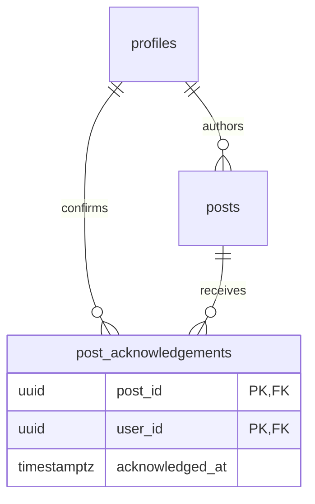
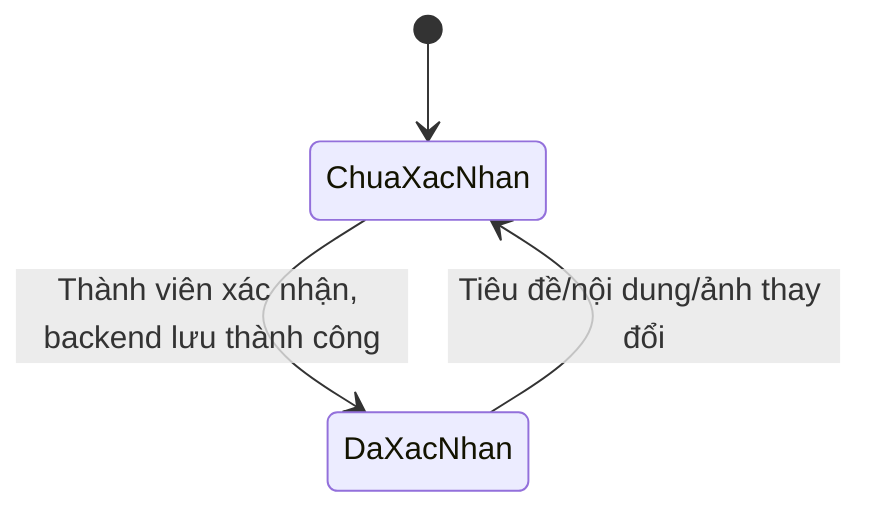

# Báo cáo nâng cấp Community Board

Ngày cập nhật: 21/10/2026.

## Phạm vi đã triển khai

Ứng dụng tiếp tục sử dụng Flutter, BLoC, GetIt/Injectable, use case, repository và Supabase như mã nguồn ban đầu. Không bổ sung thư viện quản lý trạng thái hoặc kiến trúc mới.

| Hạng mục | Hành vi mới |
|---|---|
| Phân loại | Ba loại: Thông báo, Quy định, Tin hoạt động. Chọn khi thêm/sửa; lọc trên bảng tin. |
| Ghim bài | Chọn trong form thêm/sửa. Supabase sắp xếp bài ghim trước, sau đó thời gian giảm dần và ID để phân trang ổn định. |
| Xác nhận đã đọc | Quản trị viên bật yêu cầu theo từng bài. Thành viên bấm “Tôi đã đọc”; chỉ cập nhật giao diện sau khi backend lưu thành công. |
| Tình hình xác nhận | Quản trị viên mở danh sách đã/chưa xác nhận, xem tên, avatar và thời điểm xác nhận; có phân trang và thử lại khi lỗi. |
| Danh sách người thích | Bấm số lượt thích tại thẻ bài hoặc chi tiết để xem tên, avatar, mở hồ sơ; có phân trang. |
| Giao diện | Theme Material 3, màu teal, nền sáng, banner bảng tin, nhãn bài, thẻ nội dung, điều hướng dưới trên điện thoại và NavigationRail khi rộng từ 900px. |
| Các màn hình | Làm mới bố cục đăng nhập/đăng ký, bảng tin, form bài, chi tiết, hồ sơ; đồng bộ màu và nhãn ở tìm kiếm. |
| Ảnh đa nền tảng | Dùng `UploadImage` chứa bytes và tên ảnh; `Image.memory` để xem trước và `uploadBinary` để lưu. Không phụ thuộc đường dẫn File cho ảnh trên web. |

## Quy tắc nghiệp vụ

- Giữ hai vai trò `admin` và `user`.
- Giữ quy tắc RLS được cung cấp: admin chỉ tạo bài với danh tính của mình, chỉ sửa/xóa bài của mình. Không mở quyền sửa/xóa bài của admin khác.
- Người nhận thông tin là các hồ sơ hiện có, trừ tác giả bài. Danh sách chưa xác nhận phản ánh danh bạ hiện tại, chưa phải danh sách người nhận được chốt tại thời điểm đăng. Chưa có khái niệm nhân viên nghỉ việc hoặc phòng ban.
- Like và xác nhận đã đọc là hai hành động riêng. Xác nhận ghi nhận thao tác tiếp nhận, không chứng minh người dùng đã hiểu nội dung.
- Tác giả không xác nhận bài của chính mình.
- Một người chỉ có một xác nhận cho mỗi bài. Bấm nhiều lần không tạo bản ghi trùng.
- Thay đổi tiêu đề, nội dung hoặc ảnh làm mất hiệu lực xác nhận cũ. Thay đổi ghim, loại bài, lượt thích hoặc bình luận không làm mất hiệu lực xác nhận.
- Tắt yêu cầu xác nhận sẽ xóa xác nhận của bài đó. Bật lại yêu cầu bắt đầu một lượt xác nhận mới.
- `content_version` giúp phát hiện trường hợp nội dung đổi trong lúc người dùng đang xem. Khi đó backend từ chối xác nhận và yêu cầu tải lại.
- Nhân viên chỉ đọc xác nhận của mình; admin được xem danh sách xác nhận. Danh sách người thích dùng quyền đọc likes/profiles hiện có.
- Tài khoản mới luôn có role `user` ở trigger backend. Giao diện đọc role từ `profiles`, không dựa vào role trong user metadata.

## Cách tổ chức mã để review

1. Domain: mở rộng `PostDisplay`, thêm `PostCategories`, `PostPerson`, `PostPeoplePage`, `UploadImage`; bổ sung `AcknowledgePostUsecase` và `GetPostPeopleUsecase`.
2. Data: mở rộng `PostRepositoryImpl` và `SupabasePostRemoteDataSource` theo cách xử lý `Either<Failures, T>` hiện có. Mỗi thao tác mới đi qua use case/repository, không gọi Supabase từ widget.
3. Presentation: mở rộng event/state của `PostFormBloc`, `PostListBloc`, `PostDetailBloc`; thêm `PostPeopleBloc` cho danh sách người tương tác.
4. UI dùng lại các thành phần nhỏ: `PostBadges`, `UserAvatar`, `PostPeopleSheet`, `ProfileHeader`, `AppTheme`.
5. Đăng ký dependency vẫn ở `RegisterModule`; `di.config.dart` và JSON model được sinh bằng build_runner.

Các file chính:

- `lib/core/theme/app_theme.dart`
- `lib/features/post/presentation/bloc/post_list/`
- `lib/features/post/presentation/bloc/post_people/`
- `lib/features/post/presentation/pages/post_form_page.dart`
- `lib/features/post/presentation/pages/post_detail_page.dart`
- `lib/features/post/presentation/widgets/post_people_sheet.dart`
- `../packages/domain/lib/src/post/`
- `../packages/data_supabase/lib/src/post/`

Các sửa liên quan: sửa key điều hướng hồ sơ tác giả thành `userId`; sửa hiển thị avatar; khi like thất bại chỉ rollback trạng thái like của bài, tránh mất thay đổi khác; ảnh cũ không bị xóa trước khi upload ảnh mới thành công. Chưa triển khai dọn tự động ảnh không còn được tham chiếu trong Storage.

## Cập nhật báo cáo đồ án

| Phần báo cáo | Nội dung cần cập nhật |
|---|---|
| Mục tiêu, phạm vi | Bổ sung tổ chức thông tin theo loại, ưu tiên nội dung và theo dõi xác nhận tiếp nhận. Phạm vi một doanh nghiệp. |
| Tác nhân | Giữ admin/user, giải thích rõ quản trị viên và thành viên trong doanh nghiệp. |
| Use case thêm/sửa bài | Thêm loại bài, ghim và yêu cầu xác nhận vào dữ liệu đầu vào và luồng lưu. |
| Use case xem bảng tin | Thêm lọc theo loại và thứ tự bài ghim. |
| Use case tương tác | Bổ sung “Xem danh sách người thích”. |
| Use case mới | “Xác nhận đã đọc” cho thành viên; “Xem tình hình xác nhận” cho admin. |
| Biểu đồ hoạt động | Cập nhật nhập/lưu bài; bổ sung xác nhận và tra cứu danh sách. |
| Biểu đồ trạng thái | Giữ vòng đời bài đăng hiện có; mô tả trạng thái xác nhận theo cặp người–bài, không gắn trạng thái đã đọc chung cho bài. |
| Biểu đồ lớp/ERD | Mở rộng Post và thêm PostAcknowledgement. Các lớp presentation có thể thể hiện trong thiết kế chi tiết nếu báo cáo đang mô tả chúng. |
| Giao diện, kiểm thử | Thay ảnh chụp màn hình bằng ứng dụng thực tế sau migration; bổ sung ca kiểm thử bên dưới. |

### Gợi ý đoạn mô tả phạm vi

> Ứng dụng tập trung quản lý thông tin và truyền thông nội bộ thông qua bảng tin doanh nghiệp, cho phép phân loại, ưu tiên thông tin, trao đổi phản hồi và theo dõi xác nhận đã đọc của các thành viên.

### Dữ liệu bổ sung

`posts` thêm `category`, `is_pinned`, `requires_acknowledgement`, `content_version`.

`post_acknowledgements` gồm `post_id`, `user_id`, `acknowledged_at`; khóa chính `(post_id, user_id)`; khóa ngoại tới `posts` và `profiles`, xóa liên đới khi bản ghi cha bị xóa.

Biểu đồ này chỉ áp dụng cho một người nhận đối với một bài đang yêu cầu xác nhận. Khi tắt yêu cầu, bản ghi xác nhận được xóa và thao tác xác nhận không còn áp dụng.

## Supabase: bước cần thực hiện

1. Sao lưu schema/dữ liệu như quy trình hiện tại của bạn.
2. Chạy toàn bộ `docs/supabase_board_upgrade.sql` trong Supabase SQL Editor trên dự án tương ứng. Script có transaction, tạo các RPC/view mới và giữ các RPC/view cũ.
3. Chạy `docs/supabase_verify.sql` để kiểm tra các đối tượng/quyền đã được tạo. Mỗi hàng cần trả `passed = true`; truy vấn này không thay thế kiểm thử hành vi RLS.
4. Đăng xuất và đăng nhập lại ứng dụng để nạp role từ `profiles`.
5. Dùng hai tài khoản thật: một admin và một thành viên để kiểm tra các tình huống sau.

Không cần service_role key trong ứng dụng. Không chạy lại toàn bộ SQL tạo bảng cũ mà bạn đã cung cấp; chỉ chạy file migration mới.

### Ca kiểm tra backend và tích hợp

| Ca kiểm tra | Kết quả mong đợi |
|---|---|
| Admin đăng bài loại Quy định, ghim, yêu cầu xác nhận | Bài được lưu và hiển thị đúng nhãn; đứng trước bài không ghim. |
| Đổi bộ lọc rồi tải trang tiếp | Chỉ trả loại đang chọn, vẫn ưu tiên bài ghim. |
| Thành viên đăng/sửa/xóa bài bằng request trực tiếp | Backend từ chối theo RLS hiện có. |
| Thành viên xem danh sách người thích | Trả đúng danh sách theo bảng likes, có phân trang. |
| Thành viên xác nhận hai lần | Chỉ một bản ghi, giữ thời điểm xác nhận lần đầu. |
| Thành viên tự truyền user_id hoặc thời gian xác nhận | RPC không nhận hai tham số này; ghi trực tiếp vào bảng bị từ chối. |
| Thành viên gọi danh sách đã/chưa xác nhận | Backend từ chối; không chỉ ẩn nút trên UI. |
| Admin mở danh sách xác nhận | Đúng người đã/chưa xác nhận; loại tác giả khỏi người nhận. |
| Admin sửa tiêu đề/nội dung/ảnh | Xác nhận cũ bị xóa, phiên bản nội dung tăng. |
| Admin chỉ ghim/đổi loại hoặc có like/bình luận | Xác nhận và phiên bản nội dung không đổi. |
| Thành viên xác nhận từ màn hình đang giữ nội dung cũ | Backend từ chối, yêu cầu làm mới và đọc lại. |
| Tắt yêu cầu rồi bật lại | Xác nhận cũ không quay lại. |
| Đăng ký gửi metadata role=admin bằng request trực tiếp | Hồ sơ mới vẫn là user. |
| Chọn/tải ảnh trên web và điện thoại | Xem trước từ bytes, Storage nhận đúng ảnh; cần kiểm tra với browser và thiết bị thật. |

## Kiểm chứng trong môi trường phát triển

- 30 kiểm thử đã thành công: kiểm thử nghiệp vụ mới, bố cục ở 320/390/1440px, điều hướng điện thoại/màn hình rộng, cỡ chữ 1.5, form bài, giữ ảnh cũ khi upload lỗi và 12 kiểm thử thời gian có sẵn.
- Dart analyzer trên ứng dụng, test, domain và data_supabase: không có vấn đề.
- `flutter build web --no-pub`: thành công; phần biên dịch thử Wasm tự động cũng thành công. Chưa kiểm thử tương tác bằng browser thật hoặc build bản Wasm riêng.
- Ảnh trong `docs/ui-preview/` là ảnh từ widget test với dữ liệu minh họa, không phải dữ liệu nhân viên thật hay bằng chứng tích hợp Supabase.
- Chưa chạy migration hoặc kiểm thử quyền trên Supabase thật. Việc test Dart thành công không thay thế kiểm thử RLS/RPC/Storage.
- Chưa trực tiếp kiểm tra trên thiết bị Android/iOS hoặc máy macOS/Linux. Kiểm thử bố cục mô phỏng kích thước không chứng minh ứng dụng đã chạy trên tất cả nền tảng.
